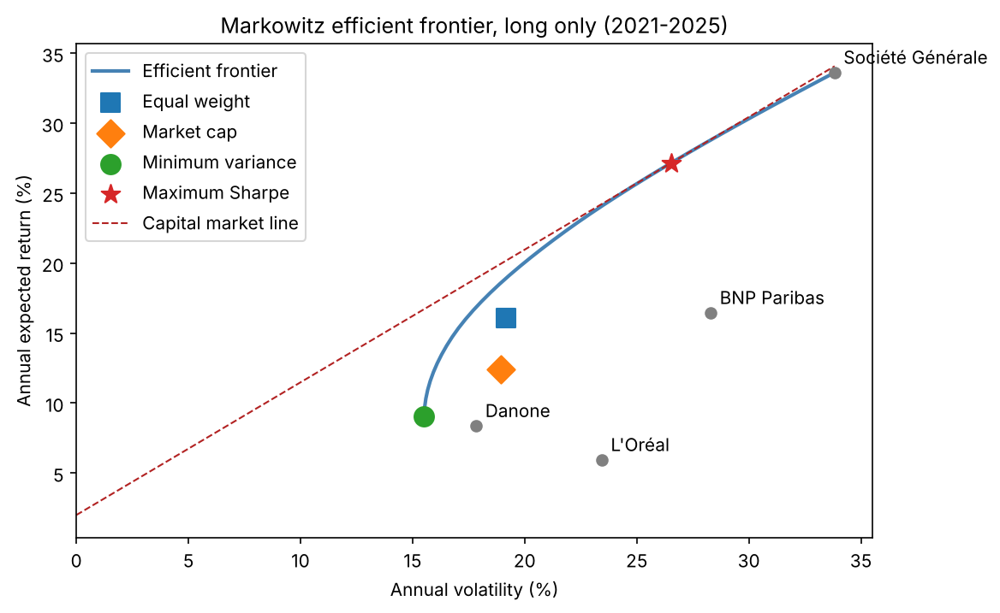
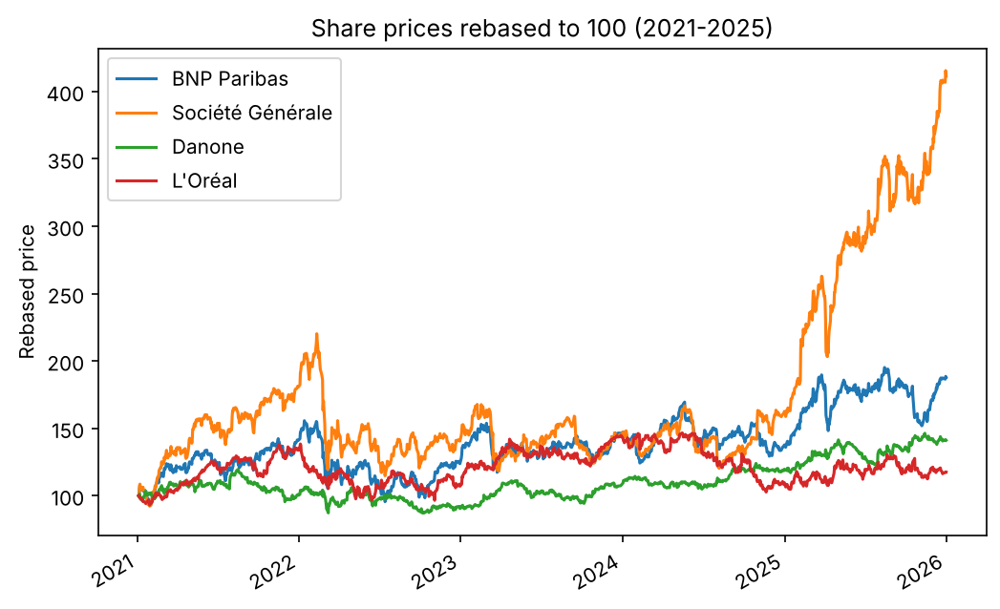

# Markowitz Efficient Frontier

Academic project in portfolio management (Master Actuariat & Finance, University of Rouen Normandie, 2026). The notebook and its comments are in French.

## Goal
Build the long-only Markowitz efficient frontier for four CAC 40 stocks (BNP Paribas, Société Générale, Danone, L'Oréal) and compare it with an equal-weight portfolio and a market-cap-weighted portfolio.

## Method
1. **Data**: daily closing prices 2021-2025 (BoursoBank), market capitalisations at end 2025.
2. **Estimation**: daily returns, annualised mean returns and covariance matrix (252 trading days).
3. **Optimisation** with `scipy` (SLSQP), weights summing to 1, no short selling:
   - minimum variance portfolio;
   - efficient frontier: minimum variance for each target return, from the minimum variance portfolio to the best-performing stock;
   - maximum Sharpe ratio portfolio, with a 2% risk-free rate (ECB deposit rate and €STR at end 2025).
4. **Out-of-sample test**: parameters estimated on 2021-2024, portfolios built on 31 December 2024 and evaluated on 2025.

## Results (2021-2025)
| Portfolio | BNP | SG | Danone | L'Oréal | Return | Volatility | Sharpe |
|---|---|---|---|---|---|---|---|
| Equal weight | 25% | 25% | 25% | 25% | 16.1% | 19.2% | 0.74 |
| Market cap | 23% | 13% | 13% | 50% | 12.4% | 19.0% | 0.55 |
| Minimum variance | 16% | 0% | 61% | 24% | 9.1% | 15.5% | 0.46 |
| Maximum Sharpe | 0% | 74% | 26% | 0% | 27.2% | 26.5% | 0.95 |

The two benchmarks lie below the frontier. The two banks are highly correlated (0.78) and weakly correlated with Danone and L'Oréal (0.22 to 0.31), which drives the diversification benefit.

**Out of sample (estimated on 2021-2024, realised in 2025)**

| Portfolio | Estimated return | Realised return | Estimated volatility | Realised volatility |
|---|---|---|---|---|
| Equal weight | 10.1% | 40.1% | 19.4% | 18.2% |
| Market cap | 7.4% | 22.1% | 18.8% | 18.5% |
| Minimum variance | 6.5% | 18.3% | 15.6% | 15.1% |
| Maximum Sharpe | 13.8% | 71.8% | 24.6% | 24.6% |

Volatilities are well predicted (gap of 1.2 points at most), expected returns are not: the 2025 bank rally, led by Société Générale, made realised returns three to five times the estimates. The maximum Sharpe portfolio did best in 2025, but this comes from one year and one stock; the minimum variance portfolio, which relies only on the covariance matrix, is the more reliable output of the model.

## Limits
- Price returns, without dividends (high for the banks).
- Only four stocks, two of them banks.
- Mean-variance criterion with constant parameters; no transaction costs.

## Repository content
- `markowitz_frontier.ipynb`: the full notebook, with outputs
- `figures/`: charts
- `data/`: expected data files (not published)

## How to reproduce
1. Install Python 3 with `numpy`, `pandas`, `scipy`, `matplotlib`.
2. Put the four price files in `data/` (see `data/README.md`).
3. Run the notebook from top to bottom.
